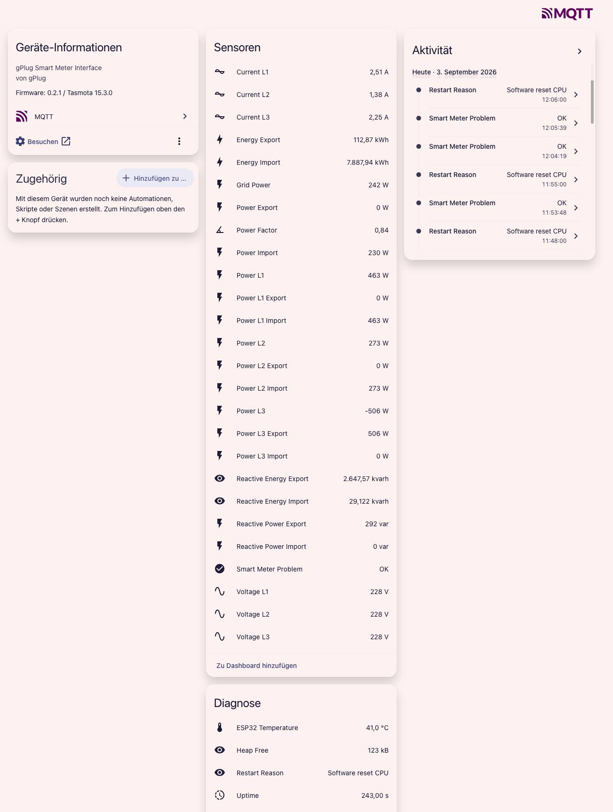

# gPlug HA

*[Deutsch](README.de.md)*

Home Assistant MQTT Auto-Discovery for the [gPlug](https://gplug.ch) smart meter interface, as a
Tasmota Berry app — no manual YAML configuration on the Home Assistant side.

Tasmota's own, earlier HA discovery feature (`SetOption19`) was removed at the firmware level. This app
fills that gap, specifically for the gPlug's built-in smart meter (P1-DSMR, Kamstrup HAN, or M-Bus,
depending on model), not as a generic Tasmota-sensor-to-HA bridge.

**No YAML, no Home Assistant add-on, no custom integration to install.** All the logic lives on the gPlug
itself; Home Assistant only needs its built-in MQTT integration, already talking to your broker.

<p>
  
</p>

## What it does

- Reads the gPlug's built-in smart meter locally via Tasmota's SML sensor (`tasmota.read_sensors()`),
  resolving the actual variable names from `script.txt` by their OBIS code — works across meters that use
  different variable names for the same measurement.
- Publishes every value the meter reports: aggregate and per-phase active power (import/export), voltage
  and current per phase, reactive power, power factor, energy import/export (including per-tariff
  registers for two-tariff meters, when the meter actually reports them), and reactive energy.
- Publishes gPlug/Tasmota device diagnostics too: ESP32 temperature, free heap, uptime, last restart
  reason.
- Publishes a Home Assistant MQTT device discovery message so all of the above shows up as entities
  automatically, with no YAML.
- Updates on every smart meter reading (not a fixed polling interval), re-publishes discovery if the
  meter's ID changes (e.g. after a meter replacement), and re-publishes discovery when Home Assistant (or
  the broker) restarts.
- Guards cumulative energy counters against momentary zero readings (a transport/parsing glitch), so a
  bad reading can't be mistaken for a meter reset and corrupt Home Assistant's long-term energy statistics.
- A small status badge on the Tasmota web UI shows the app is running, linking back to this repo.

## What you get in Home Assistant

One device, with sensors grouped by kind — reading values, per-phase power/energy detail, and device
diagnostics all show up automatically:

<p>
  
</p>

This relies entirely on Home Assistant's built-in
[MQTT integration](https://www.home-assistant.io/integrations/mqtt), via its MQTT discovery mechanism.
Once the app is running on the gPlug and publishes its first discovery message, the device shows up on its
own under **Settings → Devices & Services → MQTT** — no manual entity setup, no extra integration to
install.

## Installation

1. Download the latest `gplug_ha.tapp` from [Releases](../../releases) (or build it yourself, see below).
2. On the gPlug's Tasmota web UI: **Tools → Manage filesystem → Upload**, select `gplug_ha.tapp`.
3. Restart the device (**Restart** button on the main page). No further configuration needed — Tasmota
   scans for `*.tapp` files at boot and runs them automatically.
4. In Home Assistant, check **Settings → Devices & Services → MQTT**: the smart meter device (named
   "Smart Meter `<SMid>`") appears there automatically, with all its entities.

Your gPlug's MQTT broker must already be configured in Tasmota (**Configuration → MQTT**) and set up as an
integration in Home Assistant; this app uses that existing connection and doesn't manage its own
credentials.

## Building from source

```
cd berry
./build_tapp.sh
```

This precompiles `gplug_ha.be` and `gplug_ha_setup.be` to Berry bytecode and packs both into
`gplug_ha.tapp`. The first run builds and caches a matching `berry` CLI compiler (from the exact Tasmota
firmware source tag, since Tasmota patches Berry); subsequent runs reuse the cached binary. Requires
`curl`, `make`, and Python 3.

For firmware without automatic `.tapp` scanning, `autoexec.be.example` shows the single-file installation
path instead (upload `gplug_ha.be`, `gplug_ha_setup.be`, and `autoexec.be` separately).

## MQTT topics

All topics use the smart meter's own ID (`SMid`), not the device's Tasmota topic, so they stay stable
across device reconfiguration:

| Topic | Content | Update cadence |
|---|---|---|
| `gplug-ha/<smid>/state` | Grid power, voltage/current per phase, power factor, meter status | every meter update |
| `gplug-ha/<smid>/power` | Per-phase power import/export/net, reactive power | ~every other minute |
| `gplug-ha/<smid>/energy` | Energy import/export (+ tariffs if present), reactive energy | ~every other minute |
| `gplug-ha/<smid>/diag` | ESP32 temperature, free heap, uptime, restart reason | ~every other minute |
| `homeassistant/device/<smid>*/config` | HA MQTT discovery (four messages, one device) | on first detection, meter change, or HA restart |

## Optional: reducing publish frequency

If you only use the Home Assistant Energy dashboard and don't need second-precise live readings, you can
slow this app down to cut recorder/`state_changed` volume. Create a `gplug_ha.cfg` file (JSON) next to
`script.txt` on the gPlug's filesystem (**Tools → Manage filesystem → Create new file**) and restart:

```json
{"state_interval_s": 30, "power_interval_s": 60, "diag_interval_s": 300, "energy_interval_s": 300}
```

- `state_interval_s` (default `0`): minimum seconds between `state` topic publishes (grid power,
  voltage/current per phase, power factor). `0` means "every smart meter update", the default - useful to
  keep fast if something (e.g. a PV controller) relies on live grid power.
- `power_interval_s`, `diag_interval_s`, `energy_interval_s` (each default `120`): minimum seconds between
  publishes of the `power`, `diag`, and `energy` topics respectively - fully independent of each other, so
  e.g. `energy` (cumulative meter readings, all the Energy dashboard actually needs) can be slowed down
  without affecting `power` or `diag`.
- `detail_interval_s` (default `120`, legacy): sets the shared default for `power_interval_s`,
  `diag_interval_s`, and `energy_interval_s` when one of those isn't set explicitly. Still supported for
  configs written before the three above existed.

A missing or invalid file keeps the defaults - this is a local file, not a remote setting, so a restart is
needed for changes to take effect, same as editing `script.txt`.

## Known limitation

Tasmota occasionally logs `BRY: ERROR, bad json` for an outgoing MQTT publish from this app, on both real
gPlug hardware tested during development. The cause hasn't been fully root-caused - it does not appear to
correlate with payload size or with the number of `mqtt.publish()` calls in quick succession, and observed
data delivered to Home Assistant was not found to be affected. If you notice actual missing/stale entity
updates rather than just this log line, please open an issue with your `script.txt` and console log around
the time of the gap.

## Requirements

- gPlug (gPlugD/-D-E/-K/-M) with Tasmota, `USE_BERRY` and the smart meter module (`USE_SCRIPT`, SML sensor)
  compiled in.
- ESP32-C3 without PSRAM — this app is written with that memory budget in mind.

## Credits

- The Home Assistant mark shown in the Tasmota web UI status badge is the official "Home Assistant" glyph
  from the [Simple Icons](https://simpleicons.org/icons/homeassistant.svg) project (CC0-licensed).
- [Tasmota](https://tasmota.github.io/docs/) and its [Berry](https://tasmota.github.io/docs/Berry/)
  scripting language.

## License

[MIT](LICENSE)

This is an independent community project, not affiliated with or endorsed by the makers of the gPlug,
Home Assistant / Nabu Casa, or the Tasmota project. All product names and marks belong to their
respective owners.
